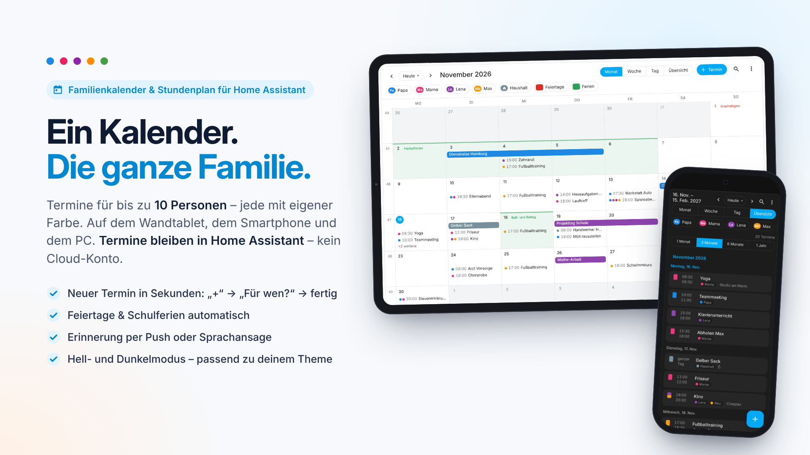
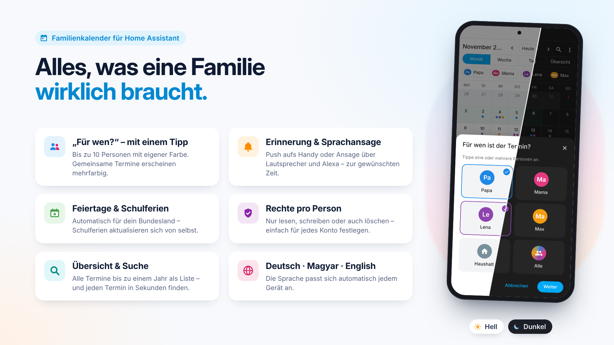
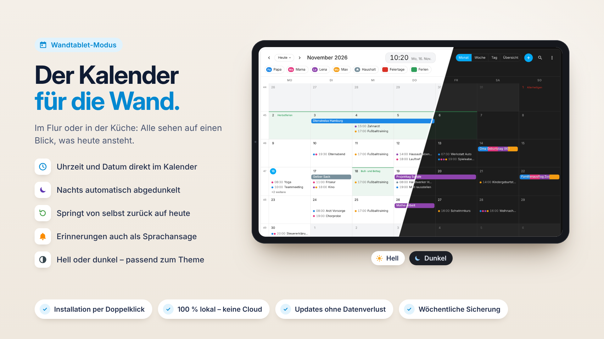

# Familienkalender

**A shared family calendar for Home Assistant – for the wall tablet, the phone and the PC. Your events stay in Home Assistant – no cloud account needed.**

**[➜ Open in your Home Assistant Marketplace](https://my.home-assistant.io/redirect/marketplace_repository/?owner=uh-si&repository=familienkalender&category=integration)**



*Deutsche Beschreibung weiter unten.*

## Features

- **Up to 10 people**, each with their own colour, plus a *Household* entry for events that belong to nobody in particular. Only active people are shown.
- **New event in seconds:** tap **+** → *For whom?* → done. Shared events for several people are shown in several colours.
- **Month, week, day and agenda view** (agenda up to one year) and a **search** across title, location, notes and people.
- **Select several days** (drag with the mouse, or long-press and drag on touch screens) to create a multi-day event.
- **Recurring events** (daily, weekly, monthly, yearly), change a single occurrence, drag & drop to move or resize, undo, birthdays with age.
- **Reminders** as push notifications and as **voice announcements** on speakers (TTS) or Alexa devices, with quiet hours.
- **Public holidays and school holidays** for every German state. Public holidays are calculated offline; school holidays are downloaded from the OpenHolidays API (see [Privacy & internet access](#privacy--internet-access)).
- **Permissions per Home Assistant user:** read only, write, or write and delete.
- **Wall tablet mode** per user: clock and date in the header, dims at night, returns to today after inactivity.
- **Light and dark mode** – follows your Home Assistant theme.
- **Print or PDF:** a month or week as an A4 calendar sheet (colour or black & white). Print from the browser, or create a PDF on any device – it is stored under *Media › Familienkalender* and can be sent to a phone as a push notification.
- **ICS import and export**, automatic weekly ICS backup.
- **Languages:** German, Hungarian and English – chosen automatically per device.





## Installation

Requires Home Assistant 2025.1 or newer. On Home Assistant 2026.11 and newer the Marketplace is built in.

1. Use the link at the top, or open **Settings → Marketplace**, choose **Add from link** and enter `https://github.com/uh-si/familienkalender`. Then select **Install**.
2. Go to **Settings → Devices & services → Add integration** and choose **Familienkalender**. Select your state and enter the names of your family members.
3. Edit a dashboard, select **Add card** and search for **Familienkalender**. The card registers itself as a dashboard resource – nothing else to configure.

All settings (people, permissions, wall tablet mode, holidays, reminders, voice announcements, backup) are under **Settings → Devices & services → Familienkalender → Configure**.

A detailed user guide (German) is in [`docs/Familienkalender-Anleitung.pdf`](docs/Familienkalender-Anleitung.pdf).

### Card options (YAML, all optional)

```yaml
type: custom:familienkalender-card
initial_view: month   # month | week | day
first_hour: 7         # first hour shown in week/day view
week_numbers: true
language: de          # de | hu | en (default: device language)
```

## Privacy & internet access

Your events, people and settings are stored only in your Home Assistant and are never sent anywhere.

The calendar uses the internet for **one thing only: school holidays**. When *Show school holidays* is enabled, it downloads them once a day (and after a restart) from the public [OpenHolidays API](https://www.openholidaysapi.org/) for the current and the next two years. The request contains only the country and state code (e.g. `DE-BY`) – no events, names or other personal data. The holidays are cached, so the calendar keeps showing them when the internet is unavailable.

- Public holidays are calculated offline – no internet needed.
- To use the calendar **without any internet access**, switch off *Show school holidays* under **Settings → Devices & services → Familienkalender → Configure → Holidays & school holidays**.
- Push notifications and voice announcements use the notification and TTS services you choose in Home Assistant; whether those need the internet depends on the service.

## Updates and your data

Updates are offered under **Settings → Updates**. Your events are stored in Home Assistant (`.storage/familienkalender.termine`) and are kept on every update. Weekly ICS backups are written to `/config/familienkalender_backup/`.

## Uninstall

1. **Settings → Devices & services → Familienkalender → Delete** (removes the card resource as well; your events stay in `.storage` and in the backups).
2. In the **Marketplace**, open Familienkalender and select **Remove**.

## Support

Please report problems and ideas in the [issue tracker](https://github.com/uh-si/familienkalender/issues).

This is a community project. It is not made, tested or supported by the Home Assistant project.

---

## Deutsch

**Ein gemeinsamer Familienkalender für Home Assistant – fürs Wandtablet, Smartphone und den PC. Deine Termine bleiben in Home Assistant – kein Cloud-Konto nötig.**

- Bis zu **10 Personen** mit eigener Farbe, dazu **Haushalt** für Termine ohne bestimmte Person.
- Neuer Termin in Sekunden: **+** → **Für wen?** → fertig. Gemeinsame Termine erscheinen mehrfarbig.
- **Monat, Woche, Tag und Übersicht** (bis zu einem Jahr) sowie eine **Suche**.
- **Mehrere Tage markieren** und daraus einen mehrtägigen Termin anlegen.
- Wiederholungen, einzelne Termine einer Serie ändern, Verschieben per Ziehen, Rückgängig, Geburtstage mit Alter.
- **Erinnerungen** per Push und **Sprachansage** (Lautsprecher oder Alexa), mit Ruhezeit.
- **Feiertage und Schulferien** für jedes Bundesland. Feiertage werden offline berechnet, Schulferien von der OpenHolidays API geladen (siehe unten).
- **Rechte pro Benutzer:** nur lesen, schreiben oder auch löschen.
- **Wandtablet-Modus** mit Uhr, Nachtabdunklung und automatischer Rückkehr zu heute.
- **Hell- und Dunkelmodus** passend zum Theme.
- **Drucken oder PDF:** Monat oder Woche als A4-Kalenderblatt (farbig oder schwarz-weiß). Drucken im Browser oder auf jedem Gerät ein PDF erstellen – es liegt unter *Medien › Familienkalender* und lässt sich per Push aufs Handy schicken.
- **ICS-Import/-Export** und wöchentliche Sicherung.
- Sprachen: **Deutsch, Ungarisch, Englisch** – automatisch je Gerät.

### Installation

1. Den Link oben verwenden oder **Einstellungen → Marketplace → Über Link hinzufügen** wählen und `https://github.com/uh-si/familienkalender` eingeben, dann **Installieren**.
2. **Einstellungen → Geräte & Dienste → Integration hinzufügen → Familienkalender**: Bundesland wählen und die Namen der Familienmitglieder eintragen.
3. Dashboard bearbeiten → **Karte hinzufügen** → **Familienkalender**.

### Datenschutz & Internetzugriff

Termine, Personen und Einstellungen bleiben ausschließlich in deinem Home Assistant. Ins Internet geht der Kalender **nur für die Schulferien**: Ist *Schulferien anzeigen* eingeschaltet, lädt er sie einmal täglich (und nach einem Neustart) von der öffentlichen [OpenHolidays API](https://www.openholidaysapi.org/) – für das laufende und die zwei folgenden Jahre. Übermittelt wird nur das Bundesland (z. B. `DE-BY`), keine Termine oder Namen. Die Daten werden zwischengespeichert, fehlt das Internet, bleiben die Ferien sichtbar. Feiertage werden offline berechnet. Wer ganz ohne Internet arbeiten möchte, schaltet *Schulferien anzeigen* unter **Einstellungen → Geräte & Dienste → Familienkalender → Konfigurieren → Feiertage & Schulferien** aus. Push-Nachrichten und Sprachansagen laufen über die in Home Assistant gewählten Dienste.

Die ausführliche Bedienungsanleitung liegt unter [`docs/Familienkalender-Anleitung.pdf`](docs/Familienkalender-Anleitung.pdf).

## License

[MIT](LICENSE)
